# Datasheet Parser

A terminal-first, evidence-backed extraction workflow for electronic component datasheets.
Select a supported model/package, extract all 17 required sections, independently reread the
source, validate the result, and export JSON with unresolved issues intact.

## نمای کلی معماری و نوع پردازش هر مرحله

این فلو مسیر پیش‌فرض استخراج و بازبینی هر **۱۷ بخش و ۵۱ نیازمندی** را نشان می‌دهد.
نوع هر نود داخل برچسب آن نوشته شده است: **Human** یعنی اقدام کاربر، **AI** یعنی درخواست
مدل زبانی، **Heuristic** یعنی قواعد انتخاب شواهد، **Code** یعنی تابع بدون فراخوانی مدل،
و **Control** یعنی کنترل ترتیب اجرا. قواعد heuristic نیز با کد اجرا می‌شوند، اما انتخاب
آن‌ها تضمین کامل بودن شواهد نیست.

مدل نوشته‌شده روی نودهای AI، مدل **پیش‌فرض پیکربندی پروژه** است:
`gpt-6-astra` با `reasoning=high` و provider برابر `codex`. این نام ادعای تشخیص مدل واقعی
پشت سرویس نیست. مدل از تنظیمات یا `--model` قابل تغییر است؛ تنظیمات استخراج هنگام ساخت
`run_id` ثبت و برای ادامهٔ همان اجرا ثابت می‌شوند. فعلاً مدل جداگانه‌ای برای هر نقش نداریم.

```mermaid
flowchart TD
    U["Human · کاربر: معرفی فایل PDF"] --> I["Code · آماده‌سازی سند<br/>datasheet ingest → ingestion.ingest()<br/>pdfplumber + PDFium: متن، جدول، تصویر و مختصات"]
    I --> DH["Heuristic · انتخاب تصاویر برای شناسایی مدل‌ها<br/>Engine.discover() + Engine.packet()<br/>صفحات آغازین، کلیدواژه‌های سفارش و صفحات کم‌متن؛ همراه متن کامل سند"]
    DH --> D["AI · شناسایی مدل‌ها، پکیج‌ها و کدهای سفارش<br/>datasheet targets → Engine.discover()<br/>gpt-6-astra · high"]
    D --> T["Human · انتخاب ترکیب مدل و پکیج<br/>datasheet extract → choose_target()"]
    T --> R["Code · ساخت اجرای مستقل با run_id<br/>Engine.create_run()<br/>ثبت هدف، provider، مدل و reasoning"]
    R --> M["AI · تهیه نقشه شواهد برای ۱۷ بخش و ۵۱ نیازمندی<br/>Engine.map_evidence() · دسته‌های ۶ صفحه‌ای<br/>gpt-6-astra · high"]

    M --> P["Heuristic · آماده‌سازی شواهد یک بخش<br/>Engine.section_packet() + Engine.packet()<br/>نقشه شواهد + کلیدواژه‌ها + صفحات همسایه و کم‌متن<br/>متن کامل سند + تصاویر منتخب"]
    P --> E["AI · استخراج تخصصی یک بخش<br/>Engine.extract_section() · نقش تخصصی از SECTIONS<br/>gpt-6-astra · high"]
    E --> V["Code · اعتبارسنجی و ثبت مسائل<br/>validate_section()<br/>شواهد، نیازمندی‌ها، واحدها، پین‌ها و مدار"]
    V --> B["AI · بازخوانی مستقل همان بخش<br/>Engine.review_section() · blind read<br/>بدون دیدن پاسخ استخراج اول<br/>gpt-6-astra · high"]
    B --> A["AI · مقایسه دو پاسخ با سند اصلی<br/>Engine.review_section() · audit<br/>ثبت خطاها و موارد جاافتاده<br/>gpt-6-astra · high"]
    A --> Q{"Control · بخش دیگری باقی مانده؟<br/>Engine.resume() · LangGraph"}
    Q -->|"بله"| P
    Q -->|"خیر"| X["Code · کنترل نهایی و ارتباط بین بخش‌ها<br/>Engine.export()<br/>validate_section() + validate_cross_sections()"]

    X --> J["Code · خروجی JSON شامل هر ۱۷ بخش<br/>datasheet export → write_export()<br/>شواهد، گزارش بازبینی و موارد حل‌نشده"]
    J --> H["Human · مشاهده شواهد و گزارش بازبینی<br/>datasheet review / inspect"]
    J --> EV["Code · ارزیابی با پاسخ مرجع انسانی، در صورت وجود<br/>datasheet evaluate → evaluation.evaluate()<br/>Precision / Recall / F1 و معیارهای پین و مدار"]

    R -.-> MON["Code · مشاهده پیشرفت در طول اجرا<br/>datasheet status / trace / coverage"]
    A -.-> MON
    MON -.-> INS["Code · مشاهده نتیجه یک بخش یا تصویر شاهد<br/>datasheet section / inspect<br/>crop_region() برای برش شاهد"]

    classDef human fill:#fff1d6,stroke:#b88720,color:#222;
    classDef llm fill:#eee5ff,stroke:#8356bd,color:#222;
    classDef heuristic fill:#e5f7e9,stroke:#428555,color:#222;
    classDef code fill:#e5f1ff,stroke:#467bac,color:#222;
    classDef control fill:#f0f0f0,stroke:#666,color:#222;
    class U,T,H human;
    class D,M,E,B,A llm;
    class DH,P heuristic;
    class I,R,V,X,J,EV,MON,INS code;
    class Q control;
```



### ارتباط فلو با کد و نقش‌های AI

نودهای بالا مراحل منطقی پردازش‌اند. گراف اجرایی داخل
[`Engine.resume()`](src/datasheet_parser/engine.py) فقط سه نود `map`، `extract` و `review`
دارد؛ انتخاب شواهد و اعتبارسنجی داخل توابع آن‌ها اجرا می‌شوند. بازخوانی مستقل و مقایسه
دو درخواست جداگانهٔ AI داخل `review_section()` هستند. در مسیر مرحله‌به‌مرحلهٔ CLI، پس از
پایان `extract`، کاربر دستور `export` را اجرا می‌کند؛ دستور یکپارچهٔ `run` این انتقال را
خودکار انجام می‌دهد. خطوط نقطه‌چین، ابزارهای مشاهدهٔ وضعیت‌اند و ترتیب اجرای مراحل نیستند.

| نقش AI | تابع | وظیفه و مدل پیش‌فرض |
|---|---|---|
| شناسایی هدف | `Engine.discover()` | یافتن ترکیب‌های واقعی مدل/پکیج/گرید با شاهد؛ `gpt-6-astra / high` |
| نقشه‌بردار شواهد | `Engine.map_evidence()` | اتصال نیازمندی‌ها به شواهد کاندید؛ `gpt-6-astra / high` |
| استخراج‌گر تخصصی | `Engine.extract_section()` | استخراج یک بخش با نقش تخصصی جدول زیر؛ `gpt-6-astra / high` |
| بازخوان مستقل | `Engine.review_section()` → `blind:{sid}` | استخراج مجدد بدون پاسخ اول؛ `gpt-6-astra / high` |
| بازبین مقایسه‌ای | `Engine.review_section()` → `review:{sid}` | سنجش هر دو پاسخ با منبع، کشف خطا و حذف‌شدگی؛ `gpt-6-astra / high` |

تخصص استخراج‌گر از [`requirements.SECTIONS`](src/datasheet_parser/requirements.py) انتخاب
می‌شود؛ این‌ها هفت نقش در پرامپت‌اند و کلاس‌ها یا سرویس‌های مستقل نیستند:

| نقش تخصصی | شمارهٔ بخش‌ها |
|---|---|
| `pins` | 1, 10 |
| `circuit` | 2 |
| `specifications` | 3, 4, 9, 11, 12, 13 |
| `application` | 5, 6, 8 |
| `mechanical` | 7, 17 |
| `identity` | 14 |
| `notes` | 15, 16 |

همهٔ درخواست‌های AI از `Engine.call()` به
[`RecordedProvider.generate()` و provider انتخاب‌شده](src/datasheet_parser/providers.py)
می‌رسند. در حالت پیش‌فرض، `CodexProvider` هر درخواست را در یک اجرای تازهٔ Codex CLI با
پرامپت، تصاویر و JSON Schema اجرا می‌کند. بازخوان مستقل پاسخ اول را نمی‌بیند، اما مدل و
منبع آن مشترک است؛ توافق دو پاسخ به‌تنهایی تأیید صحت محسوب نمی‌شود.

[`MongoStore`](src/datasheet_parser/store.py) متادیتا، وضعیت و نتایج مراحل را در MongoDB
نگه می‌دارد و GridFS فایل‌های PDF، تصاویر و لاگ‌ها را ذخیره می‌کند. `Engine.call()` پاسخ
معتبر را پیش از ثبت در دیتابیس به‌صورت اتمیک در `work/checkpoints/` ذخیره می‌کند تا قطع
اتصال باعث تکرار همان درخواست موفق نشود. ادامهٔ اجرا مراحل تکمیل‌شده را دوباره استفاده
می‌کند؛ بنابراین هر عبور از فلو لزوماً یک فراخوانی جدید مدل نیست.

اعتبارسنجی‌های این فلو قطعی و مبتنی بر قواعد کد هستند؛ صحت معنایی تمام اطلاعات را تضمین
نمی‌کنند. بازبین فعلی مسائل را ثبت می‌کند و پاسخ اولیه را خودکار اصلاح نمی‌کند. خروجی
نهایی می‌تواند `needs_review` باشد. جزئیات قواعد در
[`validation.py`](src/datasheet_parser/validation.py) و معیارهای مقایسه با مرجع انسانی در
[`evaluation.py`](src/datasheet_parser/evaluation.py) قرار دارند.

## Quick start (Windows)

Requires Python 3.11+ (development uses 3.13), uv, and MongoDB. The default inference transport
is Codex CLI signed in with ChatGPT. OpenAI API, external-worker and exact-request replay
transports use the same contracts.

```powershell
cd D:\Projects\datasheet-parser
uv sync --extra dev --python 3.13
Copy-Item .env.example .env  # only on a fresh checkout; preserve an existing .env
# Start the SSH tunnel in a separate terminal:
.\scripts\mongo-tunnel.ps1
uv run datasheet doctor
uv run datasheet smoke
```

MongoDB metadata and GridFS artifacts are stored in `datasheet_dev`. This project never
selects an existing application's database. Database names must start with `datasheet_`.
The development SSH tunnel uses the existing `dana` alias and discovers the Mongo container IP.
It does not publish a new MongoDB port on the server.

For a complete PDF-to-JSON run with interactive model/package selection:

```powershell
uv run datasheet run 'C:\path\to\datasheet.pdf' --output .\outputs\result.json
```

The command reuses existing document preparation and catalog data, creates a new run for your
selected target, extracts and reviews all 17 sections, and exports the full JSON. It uses real
model calls and may take substantial time. Keep the printed `run_id`. If interrupted, continue
that run instead of starting `run` again:

```powershell
uv run datasheet resume <run-id> --output .\outputs\result.json
```

The final JSON can be marked `needs_review`; completing the pipeline does not remove source
ambiguities or reviewer findings. A partial run is not exported as a complete result.

The individual steps are also available:

```powershell
uv run datasheet ingest 'C:\path\to\datasheet.pdf'
uv run datasheet documents
# Copy the returned parse ID:
uv run datasheet targets <parse-id>
uv run datasheet extract <parse-id>
# Select a target interactively, or supply --target <target-id>.
# Copy the run_id immediately printed before extraction starts.
uv run datasheet status <run-id>
uv run datasheet trace <run-id>
uv run datasheet section <run-id> 1 --output .\work\pinout-review.json
uv run datasheet coverage <run-id>
uv run datasheet resume <run-id>
uv run datasheet export <run-id> .\work\result.json
```

To resume and save the final JSON with one command, after any existing worker for this run has stopped:

```powershell
.\scripts\finish-run.ps1 -RunId <run-id> -Output .\outputs\result.json
```

For a bounded development experiment, use `--sections 3,4` and optionally `--no-review`.
This creates a **partial run**. Final export refuses to produce a purported complete document
until all 17 sections exist. Resume without `--sections` to finish the other sections.
`--no-review` is an explicit experimental setting; exported results remain `needs_review`.

```powershell
uv run datasheet inspect <evidence-id> --open-image
uv run datasheet review <run-id>
uv run datasheet review <run-id> --note 'Check the reset footnote' --evidence <evidence-id>
uv run datasheet evaluate .\work\result.json .\work\human-reviewed-reference.json
uv run datasheet schema .\work\result.schema.json
```

## Workflow and provenance

1. **Ingest:** immutable source SHA-256; parser/render configuration creates a parse ID.
   Page text, individual text-line boxes, detected table rows/cell boxes, page images and sparse-page
   flags are persisted. PDF coordinates use points with a top-left origin after rotation. Printed
   page labels are candidates, not substituted for physical PDF page numbers.
2. **Discover:** full document text plus relevant rendered pages identify actual supported
   model/package/grade combinations. No Cartesian product of independent names. Catalog entries
   retain source evidence and ambiguity. User selection is required before extraction.
3. **Map:** every page is processed in batches against the explicit requirement checklist.
   `candidate_for` edges are distinct from verified evidence. Coverage is scoped to run, target,
   parse, requirement and stage, not a global "page read" flag.
4. **Extract:** specialist section prompts receive full source text and selected page images.
   A separate lexical route and adjacent pages supplement the model's evidence map. All 17 sections
   have defined requirement outcomes. Every fact retains conditions, applicability, raw values
   and evidence IDs. Only section 1 contains physical pin objects; section 2 has typed circuit graphs.
5. **Review:** a fresh request independently extracts each section without the first answer.
   A subsequent source-grounded comparison reports mistakes and omissions. It cannot silently
   rewrite the original result. The current default uses the same model in separate contexts;
   this is independent context, **not independent model errors**.
6. **Validate/export:** deterministic checks flag invalid references, units, inverted limits,
   duplicate pads, malformed net membership and package mismatch. Final JSON preserves issues.
   `reviewed` does not mean electrically certified or guaranteed correct.

LangGraph sequences mapping/extraction/review. Mongo stores completed stage outputs; restarting
the graph resumes from those checkpoints. Runs freeze model/provider/reasoning settings. Create
a new run to compare a different model or prompt version.

## Persistence

Collections: `documents`, `parses`, `pages`, `regions`, `catalogs`, `runs`, `mapping_batches`,
`coverage`, `results`, `blind_reads`, `reviews`, `edges`, `events`, `human_notes`.
GridFS uses `artifacts.files` and `artifacts.chunks`. Artifact IDs are SHA-256 content hashes.
Source artifacts and recorded requests/responses are durable. Local `work/` holds image caches,
transport logs and pending response checkpoints. Keep `work/checkpoints/` until interrupted runs
have resumed: validated responses are atomically saved there before Mongo writes, so a database
disconnect does not require repeating successful inference. Checkpoints are scoped to the run,
stage and exact request fingerprint; separate evaluation runs do not share them.
Credentials never belong in artifacts or source control.

No SQLite or Neo4j is required. Explicit edges represent source/requirement relationships;
typed circuit nets represent electrical connections separately. References are checked by code.

## LLM providers

| Provider | Configuration | Behavior |
|---|---|---|
| `codex` | `codex login`; `DATASHEET_MODEL` | Fresh, read-only Codex process; text + attached PNGs; strict JSON schema |
| `openai` | `OPENAI_API_KEY` | Responses API with the same source packet and JSON schema |
| `external` | No inference credentials | Writes prompt/schema/images; exits with code 3 awaiting `submitted.json` |
| `replay` | `DATASHEET_REPLAY_SOURCE=codex` | Exact fingerprint lookup; no new inference; for software tests |

Codex inference ignores user config and has shell/web tools disabled. Tool-use events are rejected.
The adapter requests the configured model; it does not silently fall back. A missing model or
expired login fails the stage. The Codex harness is not identical to a direct API request; benchmark
the provider as part of the system. If the CLI does not report an actual model ID, telemetry leaves
that field null rather than inferring it. Subscription usage is not reported as a fabricated dollar cost.

Requests, responses, schema, elapsed time and available usage are recorded under
`work/llm/<provider>/<fingerprint>/`. Successful engine calls and provider failures archive available
logs in GridFS; timeouts preserve partial subprocess logs. Individual attempt files in the local
`attempts/<attempt-id>/` directory remain distinct; the fingerprint folder also holds the latest logs.
An external-worker response is marked human-assisted. Replay metrics are not live-model performance.
For `openai`, select a model ID available to your API account with `DATASHEET_MODEL`; a Codex model
alias is not assumed to be an API model ID. ChatGPT sign-in applies to the `codex` provider only.

### Connection troubleshooting

If `datasheet smoke` reports `Codex CLI not found` in a regular terminal, the desktop app may have
added Codex only to its own process PATH. Set `DATASHEET_CODEX_EXECUTABLE` in `.env` to the absolute
path of your installed `codex.exe`. Both `doctor` and inference use this explicit path before PATH
lookup. No global PATH change or duplicate installation is required. Update this path if an app
upgrade moves the executable; an invalid explicit path fails instead of silently using another version.

`workspace routing discovery timed out` is a Codex connection/routing failure before inference,
distinct from the application's `process_timeout` (default 600 seconds). Check the proxy and DNS
before increasing the inference timeout. To use an existing local HTTP proxy, set this in `.env`:

```dotenv
DATASHEET_CODEX_PROXY=http://127.0.0.1:2080
DATASHEET_LLM_ATTEMPTS=3
```

This proxy setting applies only to Codex child processes. It does not change Windows network
settings or MongoDB routing. The MongoDB SSH tunnel on port 27018 is a separate connection.
Run `.\scripts\mongo-tunnel.ps1 -Reconnect` in its own terminal to reconnect after up to five
SSH disconnections. Successful model responses remain recoverable locally during a DB outage.
`uv run datasheet smoke` makes a small real text/image/JSON request without requiring MongoDB;
`uv run datasheet doctor` checks login availability and MongoDB, without performing inference.
The Codex adapter retries transient routing/transport/process timeouts, up to the configured limit.
Authentication, usage limits, schema failures and rejected tool use do not trigger automatic retries.
Recovered reconnect warnings are accepted only when the turn ends successfully with valid JSON.
Each attempt streams logs to disk while running, and completed attempts are archived in GridFS.

## Contracts and evaluation

`schemas/result.schema.json` is the export schema; `schemas/section.schema.json` is the strict
model-facing schema. Pydantic also enforces all 17 unique sections, and runtime validators verify
the requirement checklist. A generic JSON Schema validator alone does not execute these extra rules.

Statuses distinguish `present`, `not_found`, `not_applicable`, `ambiguous`, `conflicting`, `unreadable`.
Processing failure is stored on the run/event, never disguised as missing source data.

Metrics currently include normalized exact claim precision/recall/F1, pin mapping, terminal-pair
net connectivity, component values/terminals, requirement disposition agreement and unnecessary
abstention counts. Common numeric unit conversions are normalized. Conditions are part of a fact's
identity. Text paraphrases are not semantically graded. Generated component names must be aligned
before scoring. Ground truth must be independently human-reviewed; a second LLM answer is not gold.

```powershell
uv run pytest -q
uv run ruff check src tests
```

Unit tests use synthetic fixtures and an in-memory test double. They verify software behavior,
not extraction accuracy. Real-provider smoke, Mongo connectivity, and real PDF extraction are
separate integration checks.

## Current boundaries

- The working ingestion backend is pdfplumber + PDFium. Docling is an optional dependency for a
  later adapter, not an implemented alternative. Sparse pages retain images and require visual reading;
  there is no dedicated OCR engine yet.
- Figure-level segmentation, automatic header/footnote linking and circuit overlays are not yet
  implemented. Whole-page images and line/table region crops are available; relationships are marked
  unverified at ingestion rather than fabricated.
- The workflow reports review issues; it does not yet automatically repair factual disagreements.
  Human review notes are append-only and do not imply that an issue was resolved.
- Prompts are versioned in code. Full-text packets are bounded; oversized documents fail explicitly
  rather than silently truncate. The 3 supplied datasheets are the initial development workload.
- Catalog discovery and graph interpretation remain model judgments. No empirical accuracy percentage
  is claimed without a separate reference dataset.
- Trace data is persisted locally/Mongo. Existing Langfuse on dana is not connected until project
  credentials and an integration configuration are supplied.
- Run one worker per run ID. Distributed worker leasing is not yet implemented; do not `resume`
  the same run in another terminal while it is still active.

## Deployment

The CLI can run on dana with the same source, lock file and database schema. Set Mongo connection,
work directory and LLM provider in the environment. `deploy/Dockerfile` packages the API/external
worker paths. Codex subscription execution requires a separately installed, authenticated Codex
runtime on the deployment host; it is not bundled with the Python container.

The current work is local development against dana's development database, not a deployed service.
