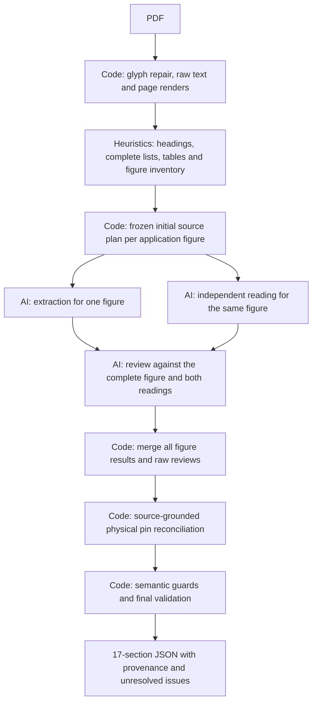

# Source-faithful quality workflow

New `budget-v1` runs default to `DATASHEET_QUALITY=quality-v1`. A run records its
quality/index versions at creation; resuming an earlier run preserves its original
behavior. `DATASHEET_QUALITY=baseline` creates a new run with the previous contracts.
This is an extraction-quality change, not a model upgrade or an accuracy score.

## Source preparation and initial retrieval

`pdf_text.py` repairs only demonstrable source glyphs. It recognizes a separately
painted bar beneath `<`/`>` and a small allowlist of engineering glyphs in positively
identified Symbol fonts. It does not infer a comparator from temperatures or replace
all `<` characters. Raw text, repaired text, coordinates and the repair proof remain
in stored regions. The parser contract changes to `regions-2`, producing a separate
parse ID rather than rewriting earlier source records.

For a CLI comparison, ingest the original PDF again and use the returned parse ID
for a new run. Merely creating a new run from an old parse does not repair its
previously stored text; resuming an old run also preserves its original source.

`structural-10` adds unnumbered source headings and retains wrapped comma-separated
lists as complete source units. Explicit supported-rate lists receive priority for
protocol/clock retrieval. These generic source predicates contain no chip-specific
answer values. Whole tables, their conditions and source images remain atomic.

Missing evidence never triggers automatic expansion. Coverage uncertainty is scoped
to relevant candidates, with a recorded reason; an unrelated unseen schematic no
longer makes every absence ambiguous. Unclassified source images can still represent
a genuine coverage gap. A `not_found` report is not proof of document-wide absence.
Table crops satisfy their exact table candidates; they do not imply a whole-page
read. Export can conservatively restore a coverage-converted `not_found` when all
relevant image candidates were actually supplied and no omission/unresolved request
or positive claim veto exists. Before/after findings and image proofs remain in audit
metadata, with an explicit limitation to the supplied evidence.

## Existing circuit extraction

`figure_workflow.py` inventories actual application captions before inference,
excluding contents/reference pages and internal, test, timing and mechanical figures.
It freezes a source plan and processes every inventoried figure as its own unit.



Each unit includes its complete figure pages and the independently parsed selected
package pin table. The blind reader sees source data, not the first AI answer. Reviews
are also figure-scoped; other separately processed figures are not missing from that
request. Logical section 2 merges every unit. Source plans and request fingerprints
protect partial checkpoint reuse. All requests are preflighted before inference at
the unchanged **20,000 estimated input token cap**, including schema, policy, drafts
and images. Provider-billed tokens can differ from the local estimate.

`netlist_normalization.py` reconciles symbolic IC names with physical pads from the
independently parsed, selected-package source table when that table was supplied to
the readers. AI pin-table disagreements remain diagnostics and section 1 stays intact.
If no unambiguous raw table is detected, the structural fallback explicitly records
that its AI pin inventory is not source-certified. An unauthorized/invalid detected
table declines normalization rather than silently falling back. Repeated supply/ground labels are resolved as a set only when their
occurrences cover the physical group on the same supported net; arbitrary A/B-to-pad
guesses are forbidden. Unknown aliases and contradictory connections remain issues.
Source package NC is not evidence that a pin is visibly unconnected in a circuit.
The source extraction remains unchanged in storage; export records the transformation.
Only previously supplied pin proofs authorize new cross-section citations.
`physical-pads-2` also accepts decorated numeric forms such as `16(VDD)` only when
the literal name matches that exact source pad. Unknown aliases, contradictory names
and undeclared schematic pseudo-nodes remain errors. A supported, cited singleton
NC marker is distinguished from an external connection; multi-node or power nets
still contradict an explicit NC disposition. Raw nets remain in the audit.

## Review and semantic coverage

`review_context.py` gives partitioned reviews a compact index of sibling original
facts. It cannot certify qualifiers or correctness. An explicit missing-fact or
missing-condition allegation is reconciled only when its complete literal exactly
matches a present original field with overlapping citations. Condition reconciliation
must match the same claim. Signs, units and scientific roles are not normalized away.
Raw reviews and reconciliation decisions remain in export metadata.

If a resumed quality review previously recorded three HTTP 504 gateway attempts,
transport recovery uses one complete requirement per review part. Every part retains
the same frozen evidence and complete scoped answers, model, reasoning and input cap;
all parts are preflighted before inference. Successful parts remain reusable. This
handles a transport failure without changing evidence or pretending a smaller source
was fully reviewed. Baseline runs and already completed reviews remain unchanged.

Detailed review issues replace redundant `unverified_claim` warnings through explicit
links; they do not become positive support. Absent quantities do not require invented
numbers. Coverage-derived uncertain absence may lack a positive citation, but a
present or ambiguous positive fact still requires supplied source evidence.

`quality_policy.py` asks each reader to distinguish every required subfield, source
scenario and applicability predicate. Deterministic guards flag clear ownership
mistakes, such as thermal/reflow data in package geometry or operating supply ranges
in protection behavior. Guards do not silently move, delete or certify claims.
Subfield metadata describes extracted claims; it is not a human gold-standard score.

## Reproducible comparison

The original CY7C64225-28PVXC output is preserved separately. Run the same PDF and
target with the same model/reasoning, then compare its JSON with the original:

```powershell
uv run python scripts/compare_cy_quality.py `
  --before outputs/CY7C64225-28PVXC-before-quality.json `
  --after outputs/CY7C64225-28PVXC-after-quality.json `
  --source work/cy-audit/CY7C64225.pdf `
  --output outputs/CY7C64225-quality-comparison.json
```

The utility checks exact document identity and target, then compares source-audited
probes: figures, physical pads, Table 7 predicates, the printed baud-rate list,
resistor applicability, semantic ownership and diagnostic bookkeeping. Generated
claim IDs are not matching keys. False-absence overlaps remain manual candidates.
There is no aggregate accuracy percentage: fewer recorded issues can reflect grouping,
while a newly covered diagram can reveal additional genuine errors.

The PDF/run artifacts in `work/` and `outputs/` remain ignored; no API key, prompts,
customer uploads or large outputs are committed. Tests use offline source fixtures.

## CY7C64225 live comparison (2026-10-12)

The same byte-original 21-page PDF, revision `*G`, and first target
`CY7C64225-28PVXC / 28-pin SSOP (PV)` were used for both outputs. The source SHA-256
is `7605109dd92469ca495d2e70e1ff6e51fad63a2206ca5fbca52d31ac2b9aa80c`.
Both runs used `openai/gpt-5.5`, medium reasoning and three workers. The new parse
and run use the repaired source/index contracts; the original output was preserved.

| Source-audited observation | Before | After |
| --- | --- | --- |
| Application figure inventory, pages 7–13 | Figures 3–4 (2 circuits) | Figures 3–9 (7 circuits) |
| Circuits accounting for all 28 physical IC pad IDs | 0 of 2 | 3 of 7: Figures 3, 6 and 9 |
| Table 7 ISB/ISBH temperature predicates in sections 9 and 15 | Four predicates lose inclusive boundaries | All four match the printed inequalities |
| Explicit baud-rate list in section 12 | First 6 values | All 17 values, including 56000 |
| Figure 3/4 0.01 µF capacitor endpoints | WAKEUP–GND | WAKEUP–VDD, parallel with SW2 |
| Clear wrong requirement ownership detected by deterministic guards | 24 claims | 0 claims |
| False missing-quantity warnings on absent quantities | 3 | 0 |

The Table 7 predicates are `0°C ≤ TA ≤ 55°C` for ISB and `55°C < TA ≤ 70°C`
for ISBH, at VDD = 3.3 V. The capacitor correction was independently spot-checked
against the original images on pages 7–8. Structural pad accounting and the
ownership guard do not certify every circuit edge or semantic field.

RXD/CTS 1 kΩ resistors were already recorded in the original output. The new
conditions distinguish the Figure 8 scenario from the applicability predicate
(different power sources); this is qualifier improvement, not a newly found resistor.
The final LED loading claim is a maximum sink current of 20 mA per output, verified
against page 4. Targeted source rereads corrected provisional negative-current
interpretations; those drafts and repair lineage remain archived rather than edited
into source facts. The original output already had the positive magnitude.

The downloaded final JSON validates all 17 sections and the exact 51 requirement
IDs, with 283 claims and no unreviewed section. Total issues increased **167 → 201**;
code issues increased 90 → 148 and model review issues changed 77 → 53. The larger
inventory exposes previously unexamined circuits, while new guards also change
diagnostic bookkeeping. These numbers are not an accuracy percentage.

The result remains `needs_review`. Fifty `unknown_terminal` findings involve
inconsistent peripheral/header terminal names or annotation/power/ground tokens
represented as undeclared component nodes. Figures 4, 5, 7 and 8 retain unresolved
WAKEUP/WAKE labels; an alias is not guessed merely to make the pad checks pass.
Explicit NC ambiguities and incomplete/missing source fields also remain visible.
The reflow prose/table wording discrepancy is retained for review, not silently
replaced by a selected value. Complete figure inventory does not establish complete
or correct connectivity.

The live job took 92:48 on its lifetime clock, including router 504 failures,
development pauses and targeted source rereads. It is **not an uninterrupted latency
benchmark**, and it does not establish the half-hour goal. Three recorded gateway
attempts in a review enabled requirement-scoped recovery with the same frozen source,
model, reasoning and input cap. No automatic evidence expansion was introduced.

Verified through the browser: progress reached 51/51, output was downloadable, and
the completed page had no console warnings/errors. Offline checks: **474 tests
passed**, Ruff passed. Both the demo and the original landing services stayed active.

- [Original live output](http://185.243.48.232:8095/?job=b756c7fa586a413ba560ef9091984d97), run `7d7e1e6d2a2b4afa`.
- [New live output](http://185.243.48.232:8095/?job=4b8a50b34bb54029980a9dc33d8231f8), run `e9a995f899ff450c`.
- Local final JSON: `outputs/CY7C64225-28PVXC-after-quality.json`.
- Local comparison: `outputs/CY7C64225-quality-comparison.json` (report version `cy-quality-comparison-2`).

## Limits

Caption inventory remains a heuristic and can miss unlabeled/image-only schematics.
Independent LLM readings are not independent human validation. Complete diagram and
pad coverage does not prove every wire/component value correct. Remaining retrieval
gaps, source contradictions, unprovable aliases and model errors keep `needs_review`.
The current live provider is `openai/gpt-5.5`, medium reasoning, three workers.
